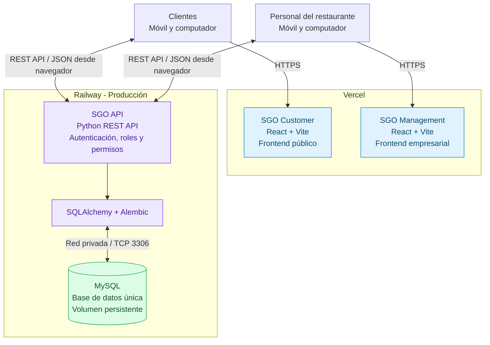
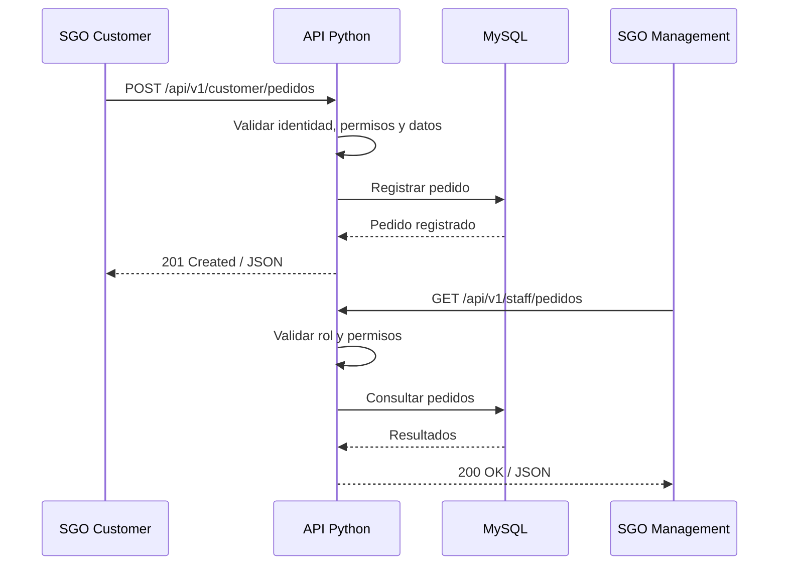
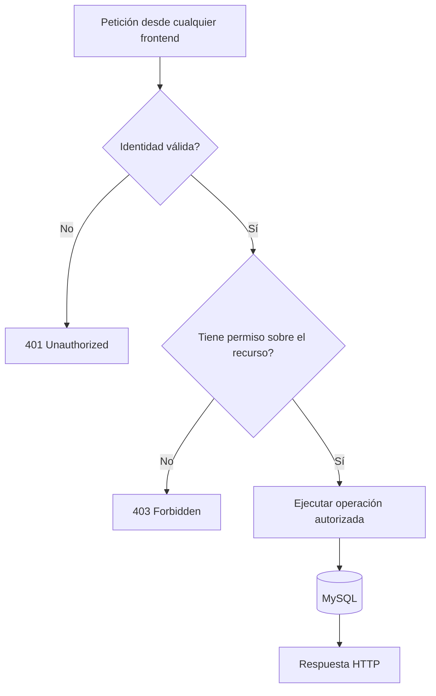

# Sabor Caleño SGO — Arquitectura de aplicaciones

## 1. Arquitectura propuesta

Equipo, la propuesta es organizar SGO en **dos aplicaciones frontend independientes, un único backend en Python y una única base de datos MySQL**.

La separación responde a las necesidades de nuestros usuarios: los clientes necesitan una interfaz comercial, principalmente móvil, mientras que el personal del restaurante necesita una interfaz operativa, enfocada exclusivamente en las funciones de su rol.

Ambos frontends serán responsive, por lo que no necesitaremos desarrollar aplicaciones diferentes para móviles y computadores. Además, podremos incorporar funcionalidades PWA de manera independiente si lo consideramos necesario.

### Diagrama de despliegue



Vercel entrega los archivos de cada frontend al navegador. Una vez cargadas, las aplicaciones React realizan peticiones HTTPS directamente a nuestra API. Ninguno de los frontends se conecta directamente a MySQL.

## 2. Frontend de clientes — SGO Customer

Vamos a orientar esta aplicación al cliente final, utilizando un enfoque **Mobile First** y adaptando la interfaz a pantallas de escritorio.

### Funcionalidades propuestas

- Página de inicio del restaurante.
- Menú digital y catálogo de productos.
- Carrito de compras.
- Realización y seguimiento de pedidos.
- Reservaciones.
- Registro e inicio de sesión.
- Historial de compras.
- Perfil del cliente.

Podremos convertir esta aplicación en una PWA para permitir su instalación desde navegadores compatibles, sin necesidad de publicar inicialmente una aplicación nativa en Play Store.

## 3. Frontend empresarial — SGO Management

Esta aplicación estará destinada exclusivamente al personal del restaurante. A diferencia del frontend de clientes, no necesitaremos páginas comerciales ni interfaces diseñadas para promocionar productos.

El personal accederá a través de una pantalla de inicio de sesión y visualizará únicamente los módulos correspondientes a sus roles y permisos.

### Roles y funcionalidades de referencia

| Rol | Funcionalidades |
| --- | --- |
| Administrador | Gestión general del sistema. |
| Gerente | Reportes, estadísticas y supervisión. |
| Cajero | Ventas, pagos y facturación. |
| Mesero | Gestión de mesas y pedidos. |
| Cocinero | Consulta y preparación de pedidos. |
| Personal de inventario | Entradas, salidas y existencias. |

No vamos a crear un frontend por cada rol. Utilizaremos una sola aplicación empresarial con rutas protegidas, layouts, componentes reutilizables y control de acceso según los permisos definidos en el backend.

Los roles y módulos anteriores son ejemplos; debemos ajustarlos a los requisitos reales de SGO.

## 4. ¿Por qué dos frontends?

Podríamos desarrollar todo en una sola aplicación React utilizando rutas diferenciadas. Sin embargo, para SGO proponemos separar ambas aplicaciones porque sus objetivos y flujos de navegación son diferentes.

| Característica | Un frontend | Dos frontends |
| --- | --- | --- |
| Complejidad inicial | Menor | Moderada |
| Separación de interfaces | Mediante rutas | Por aplicación |
| Despliegues independientes | No, en un despliegue único | Sí |
| Mantenimiento independiente | Limitado | Sí |
| Dependencias compartidas | Directamente | Mediante paquetes compartidos, si se necesitan |
| Personalización del diseño | Sí | Mayor independencia |
| Organización del equipo | Una aplicación | Por aplicación |
| Escalabilidad independiente | Limitada | Mayor |

Esta separación también implica mantener dos configuraciones de construcción, dos despliegues y posiblemente componentes duplicados. Si identificamos funcionalidades comunes, podremos extraerlas a un paquete compartido en el futuro.

La ventaja es que podremos trabajar en la experiencia del cliente sin tener que desplegar nuevamente el panel empresarial, y viceversa. Los cambios en la API compartida deberán mantener compatibilidad con ambos frontends.

## 5. Estructura del repositorio

Podemos conservar un único repositorio de GitHub y organizar las tres aplicaciones en carpetas independientes, siguiendo un enfoque monorepo.

```text
Proyecto-Formativo-SGO/
├── Backend/
│   ├── app/
│   │   ├── models/
│   │   ├── routes/
│   │   ├── services/
│   │   └── controllers/
│   ├── migrations/
│   ├── alembic.ini
│   ├── requirements.txt
│   └── .env.example
├── Frontend-Customer/
│   ├── src/
│   │   ├── api/
│   │   ├── components/
│   │   ├── pages/
│   │   └── services/
│   ├── package.json
│   └── .env.example
├── Frontend-Management/
│   ├── src/
│   │   ├── api/
│   │   ├── components/
│   │   ├── pages/
│   │   ├── layouts/
│   │   ├── guards/
│   │   └── services/
│   ├── package.json
│   └── .env.example
├── docs/
│   └── DEPLOYMENT.md
└── README.md
```

La estructura es una propuesta. No necesitamos reorganizar los módulos del backend que ya funcionan; debemos adaptar los nombres de carpetas y las ramas de despliegue a la organización actual del repositorio.

En Vercel crearemos un proyecto por frontend, configurando su respectivo directorio raíz. En Railway configuraremos el directorio raíz del backend.

## 6. Configuración de los endpoints

Los dos frontends consumirán la misma API REST. Podemos organizar los endpoints según sus responsabilidades y permisos, sin duplicar la lógica de negocio.

| Método | Endpoint de ejemplo | Acceso |
| --- | --- | --- |
| GET | `/api/v1/public/menu` | Público |
| POST | `/api/v1/auth/login` | Clientes y personal |
| POST | `/api/v1/customer/pedidos` | Cliente autenticado |
| GET | `/api/v1/customer/mis-pedidos` | Cliente autenticado |
| GET | `/api/v1/staff/pedidos` | Personal autorizado |
| PATCH | `/api/v1/staff/pedidos/1/estado` | Personal autorizado |
| POST | `/api/v1/admin/productos` | Administrador autorizado |
| GET | `/api/v1/admin/reportes` | Administrador autorizado |

Estos endpoints son ejemplos de organización, no una obligación de renombrar las rutas existentes.

### Comunicación entre aplicaciones



Así, un pedido realizado desde la aplicación de clientes podrá aparecer en la aplicación empresarial a través de la misma API y base de datos. Si necesitamos actualizaciones en tiempo real, podremos incorporar posteriormente polling, SSE o WebSockets.

## 7. Variables de entorno

### Frontend-Customer/.env

```dotenv
VITE_API_URL=https://sgo-api.up.railway.app/api/v1
```

### Frontend-Management/.env

```dotenv
VITE_API_URL=https://sgo-api.up.railway.app/api/v1
```

Los dos proyectos utilizarán la misma URL del backend. En desarrollo podemos apuntar a nuestra API local, por ejemplo `http://localhost:8000/api/v1`, ajustando el puerto real.

En producción configuraremos `VITE_API_URL` en las variables de entorno de cada proyecto Vercel. Las variables con prefijo `VITE_` son públicas en el navegador; nunca debemos incluir contraseñas ni claves privadas en ellas.

### Backend — Variables de Railway

```dotenv
APP_ENV=production
DEBUG=false

DB_HOST=${{MySQL.MYSQLHOST}}
DB_PORT=${{MySQL.MYSQLPORT}}
DB_NAME=${{MySQL.MYSQLDATABASE}}
DB_USER=${{MySQL.MYSQLUSER}}
DB_PASSWORD=${{MySQL.MYSQLPASSWORD}}

CORS_ORIGINS=https://sgo-clientes.vercel.app,https://sgo-empresa.vercel.app
```

Las referencias de Railway deben coincidir con el nombre real del servicio MySQL y sus variables. Debemos verificar que utilicen la conexión privada. Los dominios anteriores son ilustrativos.

Configuraremos el backend para leer `CORS_ORIGINS` como una lista de orígenes permitidos. Por ejemplo, en Python:

```python
import os

cors_origins = [
    origin.strip()
    for origin in os.environ["CORS_ORIGINS"].split(",")
    if origin.strip()
]
```

Integraremos esa lista en el middleware CORS de nuestro framework. Si utilizamos cookies de sesión, también debemos configurar sus atributos de seguridad, la protección CSRF y el envío de credenciales según los dominios utilizados.

Las credenciales reales permanecerán exclusivamente en Railway o en el `.env` local ignorado por Git. Los archivos `.env.example` sí podrán formar parte del repositorio.

## 8. Seguridad mediante roles y permisos

Separar los frontends no constituye una barrera de seguridad por sí misma. Un cliente podría conocer la URL de la aplicación empresarial o intentar consumir sus endpoints directamente.

Por esta razón, nuestro backend será responsable de validar la identidad del usuario, su rol, sus permisos y el acceso a cada recurso solicitado.



En React utilizaremos rutas protegidas y ocultaremos los módulos que no correspondan al rol del usuario, pero estas medidas únicamente controlan la experiencia de navegación. La autorización real debe aplicarse en cada endpoint protegido del backend.

CORS tampoco reemplaza la autenticación ni la autorización. Debemos impedir, entre otras cosas, que un cliente consulte pedidos de otro cliente o acceda a funcionalidades administrativas.

## 9. Infraestructura final de producción

Tendremos cuatro componentes desplegados: dos frontends, un backend y una base de datos.

| Servicio | Plataforma | Dominio o acceso de ejemplo |
| --- | --- | --- |
| SGO Customer | Vercel | `sgo-clientes.vercel.app` |
| SGO Management | Vercel | `sgo-empresa.vercel.app` |
| SGO API | Railway | `sgo-api.up.railway.app` |
| SGO Database | Railway | Red privada MySQL, puerto 3306 |

Los dos proyectos Vercel y el servicio Python de Railway se vincularán al repositorio de GitHub. Configuraremos cada despliegue con su rama y directorio correspondiente.

El servicio MySQL tendrá almacenamiento persistente. Mantendremos Alembic como sistema único de migraciones y ejecutaremos `alembic upgrade head` desde el backend, no desde los frontends. Las migraciones deberán probarse antes de aplicarse en producción.

### Dominios propios (opcional)

Si más adelante adquirimos un dominio, podemos distribuir las aplicaciones de la siguiente manera:

| Dominio propuesto | Aplicación |
| --- | --- |
| `saborcaleno.com` | Frontend de clientes |
| `gestion.saborcaleno.com` | Frontend empresarial |
| `api.saborcaleno.com` | Backend Python |

Estos dominios son únicamente ejemplos y están sujetos a disponibilidad y configuración.

## 10. Stack tecnológico definitivo propuesto

| Tecnología | Cantidad | Responsabilidad |
| --- | --- | --- |
| React + Vite | 2 aplicaciones | Interfaces responsive |
| Python REST API | 1 aplicación | Lógica de negocio, autenticación y endpoints |
| MySQL | 1 base de datos de producción | Persistencia centralizada |
| SQLAlchemy | 1 ORM | Acceso a datos |
| Alembic | 1 sistema de migraciones | Versionado de la estructura de la base de datos |
| Vercel | 2 proyectos | Despliegue de ambos frontends |
| Railway | 1 proyecto con 2 servicios de producción | Despliegue del backend y MySQL |
| GitHub | 1 repositorio | Control de versiones del código |

---

## Conclusión

La arquitectura que proponemos para SGO consiste en mantener **dos frontends especializados, ambos responsive y opcionalmente instalables como PWA, conectados a un único backend y una única base de datos**.

Con esta separación podremos trabajar de forma independiente en la experiencia del cliente y en la operación del restaurante, sin duplicar la lógica de negocio, las migraciones ni la información almacenada.

Antes de implementar esta propuesta, debemos verificar las rutas, roles, estructura de carpetas, framework del backend y ramas reales de nuestro repositorio. Este documento define la arquitectura objetivo; no representa un despliegue ya realizado.
