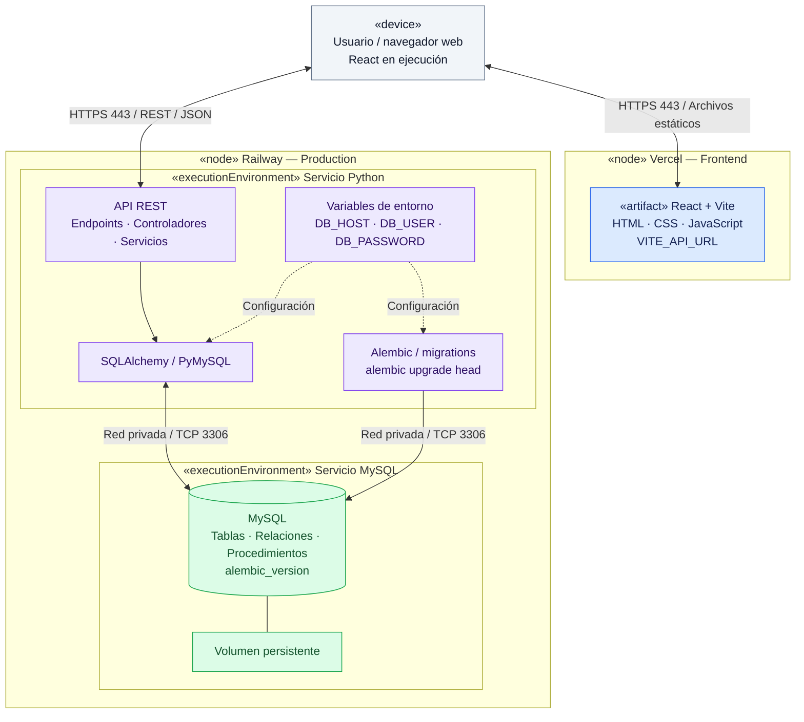
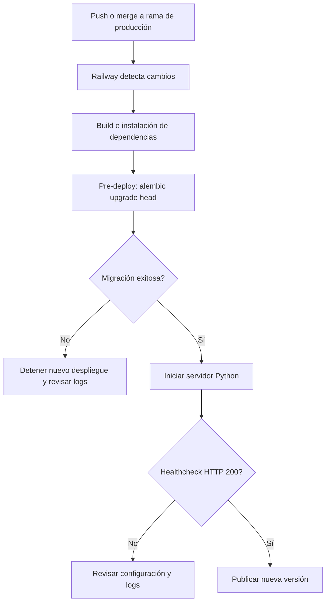
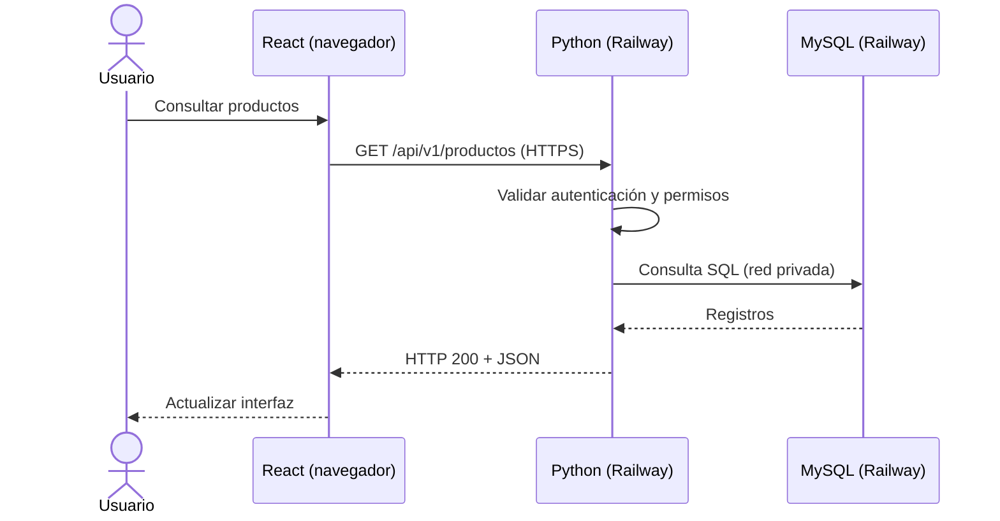

# Sabor Caleño SGO — Despliegue en producción

Guía de configuración y despliegue del Sistema de Gestión Operacional (SGO) utilizando React, Python y MySQL. La infraestructura separa el frontend, el backend y la base de datos, conservando las migraciones existentes de Alembic.

> **Estado:** arquitectura propuesta. Los dominios, rutas de archivos, nombres de servicios y comandos de inicio deben ajustarse al repositorio real antes del despliegue.

## Contenido

- [Arquitectura](#1-arquitectura)
- [Estructura del proyecto](#2-estructura-del-proyecto)
- [Configuración del backend](#3-configuración-del-backend)
- [Configuración de Railway](#4-configuración-de-railway)
- [Migraciones con Alembic](#5-migraciones-con-alembic)
- [Configuración del frontend y Vercel](#6-configuración-del-frontend-y-vercel)
- [Comunicación con la API REST](#7-comunicación-con-la-api-rest)
- [Ambientes](#8-ambientes)
- [Seguridad](#9-seguridad)
- [Lista de verificación](#10-lista-de-verificación)

## 1. Arquitectura

| Componente | Tecnología | Alojamiento |
| --- | --- | --- |
| Frontend | React + Vite | Vercel |
| Backend | Python / API REST | Railway |
| Base de datos | MySQL | Railway |
| ORM | SQLAlchemy | Backend |
| Driver de BD | PyMySQL (referencia) | Backend |
| Migraciones | Alembic | Backend |
| Cliente HTTP | Axios | Frontend |
| Control de versiones | Git | GitHub |
| Despliegue continuo | CI/CD | Vercel y Railway |

### Diagrama de despliegue



El navegador descarga React desde Vercel y realiza peticiones HTTPS directamente a la API pública de Python. El backend se comunica con MySQL mediante la red privada de Railway. La base de datos de producción no debe quedar expuesta a Internet.

## 2. Estructura del proyecto

Estructura de referencia; no es necesario reorganizar el código existente si ya cumple estas responsabilidades.

```text
Proyecto-Formativo-SGO/
├── Backend/
│   ├── app/
│   │   ├── config/
│   │   │   └── database.py
│   │   ├── models/
│   │   ├── routes/
│   │   └── services/
│   ├── migrations/
│   │   ├── versions/
│   │   └── env.py
│   ├── alembic.ini
│   ├── main.py
│   ├── requirements.txt
│   ├── railway.json
│   ├── .env.example
│   └── .gitignore
└── Frontend/
    ├── src/
    │   ├── api/
    │   │   └── apiClient.js
    │   ├── services/
    │   ├── components/
    │   └── pages/
    ├── package.json
    ├── vercel.json
    ├── .env.example
    └── .gitignore
```

Si frontend y backend se mantienen en ramas o repositorios independientes, configurar cada servicio para desplegar su rama y directorio correspondientes.

## 3. Configuración del backend

### Variables de entorno locales

Crear `Backend/.env.example` y copiarlo como `.env` para trabajar localmente.

```dotenv
APP_ENV=development
DEBUG=false
SECRET_KEY=

DB_HOST=localhost
DB_PORT=3306
DB_NAME=sgo
DB_USER=root
DB_PASSWORD=

FRONTEND_URL=http://localhost:5173
```

Completar las credenciales locales y generar una clave secreta cuando sea necesaria:

```bash
python -c "import secrets; print(secrets.token_hex(32))"
```

### Dependencias

Conservar las dependencias actuales en `requirements.txt`. Si todavía faltan las de conexión y migración, instalar las siguientes (adaptar al driver ya usado por el proyecto):

```bash
pip install sqlalchemy pymysql alembic python-dotenv
```

En producción, registrar las versiones probadas de las dependencias en `requirements.txt`.

### Conexión centralizada

Ejemplo para `Backend/app/config/database.py`, utilizando SQLAlchemy y PyMySQL:

```python
import os
from dotenv import load_dotenv
from sqlalchemy import URL, create_engine
from sqlalchemy.orm import sessionmaker

load_dotenv(override=False)

DATABASE_URL = URL.create(
    drivername="mysql+pymysql",
    username=os.environ["DB_USER"],
    password=os.environ["DB_PASSWORD"],
    host=os.environ["DB_HOST"],
    port=int(os.environ["DB_PORT"]),
    database=os.environ["DB_NAME"],
    query={"charset": "utf8mb4"},
)

engine = create_engine(
    DATABASE_URL,
    pool_pre_ping=True,
    pool_recycle=280,
)

SessionLocal = sessionmaker(
    bind=engine,
    autoflush=False,
    autocommit=False,
)
```

`URL.create()` evita construir manualmente una URL con contraseñas que contienen caracteres especiales. La aplicación debe cerrar sus sesiones de base de datos al finalizar cada petición. Si ya existe un módulo de conexión, adaptarlo en lugar de crear un segundo motor innecesario.

### CORS y healthcheck

Configurar el middleware CORS del framework para permitir el origen indicado en `FRONTEND_URL`, sin comodines en producción cuando se usan credenciales. Ejemplo de origen: `https://sgo.vercel.app`.

Implementar un endpoint público de comprobación de salud, por ejemplo `GET /api/v1/health`, que devuelva HTTP 200 cuando el servicio esté listo. Puede comprobar la disponibilidad de MySQL sin revelar credenciales ni detalles internos. Ajustar la ruta a la API existente.

## 4. Configuración de Railway

1. Crear un proyecto en [Railway](https://railway.com/).
2. Crear el servicio **MySQL** y comprobar que disponga de un volumen persistente.
3. Crear el servicio **SGO-Backend** desde el repositorio de GitHub.
4. Seleccionar la rama y el directorio raíz que contienen el backend.
5. Configurar las variables, el comando de migración y el comando de inicio.
6. Generar un dominio público HTTPS únicamente para el backend.
7. Desactivar el TCP Proxy público de MySQL en producción si no se necesita.

### Variables del servicio SGO-Backend

En **Variables → RAW Editor** de Railway:

```dotenv
APP_ENV=production
DEBUG=false
SECRET_KEY=REEMPLAZAR_POR_CLAVE_SEGURA

DB_HOST=${{MySQL.MYSQLHOST}}
DB_PORT=${{MySQL.MYSQLPORT}}
DB_NAME=${{MySQL.MYSQLDATABASE}}
DB_USER=${{MySQL.MYSQLUSER}}
DB_PASSWORD=${{MySQL.MYSQLPASSWORD}}

FRONTEND_URL=https://sgo.vercel.app
```

- `MySQL` debe coincidir con el nombre real del servicio en Railway.
- Verificar que `DB_HOST` resuelva al dominio privado del servicio, por ejemplo `mysql.railway.internal`.
- Reemplazar `FRONTEND_URL` por el dominio real de Vercel, sin una ruta final.
- Railway inyecta estas variables en el proceso: no es necesario subir `.env` a producción.
- Las credenciales del servicio MySQL son útiles para el despliegue inicial; posteriormente, separar los permisos de la aplicación y del usuario que ejecuta migraciones.

### Configuración de despliegue

En **SGO-Backend → Settings → Deploy**:

| Parámetro | Valor |
| --- | --- |
| Pre-Deploy Command | `alembic upgrade head` |
| Start Command (FastAPI) | `uvicorn main:app --host 0.0.0.0 --port $PORT` |
| Start Command (Flask) | `gunicorn main:app --bind 0.0.0.0:$PORT` |
| Healthcheck Path | `/api/v1/health` (si existe) |
| Public Networking | Activado para el backend |

Seleccionar **un solo comando de inicio** según el framework real. Ajustar `main:app` al módulo y objeto de aplicación existentes, e incluir Uvicorn o Gunicorn en `requirements.txt`, según corresponda.

### railway.json (opcional)

Ejemplo para FastAPI. En Flask, reemplazar `startCommand` por el comando de Gunicorn correspondiente.

```json
{
  "$schema": "https://railway.com/railway.schema.json",
  "deploy": {
    "preDeployCommand": ["alembic upgrade head"],
    "startCommand": "uvicorn main:app --host 0.0.0.0 --port $PORT",
    "healthcheckPath": "/api/v1/health",
    "restartPolicyType": "ON_FAILURE"
  }
}
```

Si el archivo está en un subdirectorio del repositorio, comprobar que Railway esté usando la ruta de configuración correcta.

## 5. Migraciones con Alembic

Las migraciones permanecen versionadas en `Backend/migrations/`. No es necesario crear las tablas manualmente en Railway si el historial de migraciones contiene toda la estructura.

### Configurar migrations/env.py

Integrar el siguiente fragmento en el archivo existente, después de inicializar `config`. Conservar `target_metadata`, los imports de modelos y las funciones de ejecución de las migraciones.

```python
from alembic import context
from app.config.database import DATABASE_URL

config = context.config

config.set_main_option(
    "sqlalchemy.url",
    DATABASE_URL.render_as_string(hide_password=False).replace("%", "%%"),
)
```

Verificar que el motor usado en `run_migrations_online()` lea esta configuración o utilice directamente el mismo motor centralizado. Eliminar conexiones fijas a `localhost` que puedan prevalecer sobre las variables de entorno.

### Ejecutar las migraciones

Desde la raíz del backend, con las variables del entorno de destino configuradas:

```bash
alembic upgrade head
```

Si MySQL en Railway está vacío y el historial de migraciones es completo y compatible, Alembic creará las tablas, relaciones, índices y restricciones, además de `alembic_version`, que registra las revisiones aplicadas.

| Elemento | Resultado |
| --- | --- |
| Tablas y columnas | Se crean si están en las migraciones |
| Llaves primarias y foráneas | Se crean si están definidas |
| Índices y restricciones | Se crean si están definidos |
| Procedimientos, triggers y vistas | Solo si se crean explícitamente en las migraciones |
| Datos iniciales | Solo si existen migraciones de datos o un proceso de seed |
| Registros de la base local | No se transfieren automáticamente |

### Comandos útiles

```bash
alembic current                         # Revisiones aplicadas en la BD
alembic heads                           # Revisiones finales del repositorio
alembic history                         # Historial de migraciones
alembic revision --autogenerate -m "descripcion"  # Generar una revisión
alembic upgrade head                    # Aplicar migraciones pendientes
```

Revisar las migraciones autogeneradas antes de aplicarlas. No ejecutar `alembic init` si el directorio de migraciones ya existe. Si hay múltiples heads, resolver la divergencia de revisiones en el equipo antes de desplegar.

### Despliegue automatizado



Railway ejecutará las migraciones antes de iniciar la nueva versión del backend. Si no hay revisiones pendientes, Alembic no volverá a crear las tablas.

> **Precaución:** probar cada migración en desarrollo antes de producción. MySQL puede aplicar cambios DDL parcialmente si una migración falla. Mantener backups, evitar ejecuciones simultáneas y diseñar cambios compatibles con la versión anterior del backend durante el despliegue.

Para ejecutar migraciones desde un computador local contra Railway, utilizar únicamente un entorno de desarrollo con TCP Proxy habilitado y las credenciales públicas correspondientes. La red privada de Railway no es accesible directamente desde localhost. En producción, preferir el pre-deploy dentro de Railway.

## 6. Configuración del frontend y Vercel

### Frontend/.env.example

```dotenv
VITE_API_URL=http://localhost:8000/api/v1
```

Ajustar el puerto y prefijo a los usados por el backend local.

### Cliente HTTP centralizado

Instalar Axios si todavía no está incluido en el proyecto:

```bash
npm install axios
```

Archivo `Frontend/src/api/apiClient.js`:

```javascript
import axios from "axios";

const apiClient = axios.create({
    baseURL: import.meta.env.VITE_API_URL,
    timeout: 15000,
    headers: {
        "Content-Type": "application/json"
    }
});

export default apiClient;
```

### Configurar Vercel

1. Importar el proyecto de frontend desde GitHub en [Vercel](https://vercel.com/).
2. Seleccionar la rama de producción y el directorio del frontend.
3. Configurar los parámetros de construcción.
4. En **Settings → Environment Variables**, crear `VITE_API_URL` para Production.
5. Desplegar el frontend y actualizar `FRONTEND_URL` en Railway con su dominio real.

| Parámetro | Valor |
| --- | --- |
| Framework Preset | Vite |
| Install Command | `npm ci` (requiere `package-lock.json`) |
| Build Command | `npm run build` |
| Output Directory | `dist` |
| Production Branch | Rama estable definida por el equipo |
| VITE_API_URL | `https://sgo-backend.up.railway.app/api/v1` (ejemplo) |

Las variables `VITE_` forman parte del código público del frontend y se incorporan durante la construcción. Si cambia la URL del backend, realizar un nuevo despliegue de React.

### vercel.json

Si se utiliza React Router con rutas del lado del cliente, agregar este archivo en la raíz del frontend para permitir la recarga de páginas internas:

```json
{
  "rewrites": [
    {
      "source": "/(.*)",
      "destination": "/index.html"
    }
  ]
}
```

## 7. Comunicación con la API REST

Ejemplo de servicio de productos en `Frontend/src/services/productoService.js`. Los endpoints son ilustrativos y deben coincidir con los definidos por el backend.

```javascript
import apiClient from "../api/apiClient";

export const productoService = {
    async obtenerTodos() {
        const { data } = await apiClient.get("/productos");
        return data;
    },
    async obtenerPorId(id) {
        const { data } = await apiClient.get(`/productos/${id}`);
        return data;
    },
    async crear(producto) {
        const { data } = await apiClient.post("/productos", producto);
        return data;
    },
    async actualizar(id, producto) {
        const { data } = await apiClient.put(`/productos/${id}`, producto);
        return data;
    },
    async eliminar(id) {
        const { data } = await apiClient.delete(`/productos/${id}`);
        return data;
    }
};
```

| Método | Endpoint | Operación |
| --- | --- | --- |
| GET | `/api/v1/productos` | Listar productos |
| GET | `/api/v1/productos/{id}` | Consultar producto |
| POST | `/api/v1/productos` | Crear producto |
| PUT | `/api/v1/productos/{id}` | Actualizar producto |
| DELETE | `/api/v1/productos/{id}` | Eliminar producto |

### Diagrama de secuencia



React no conoce las credenciales de MySQL. Toda operación pasa por los endpoints del backend y sus controles de autorización.

## 8. Ambientes

| Componente | Development | Production |
| --- | --- | --- |
| Frontend | Localhost / Vercel Preview | Vercel Production |
| Backend | Local / Railway Development | Railway Production |
| Base de datos | MySQL_DEV | MySQL_PROD |
| Datos | Ficticios y de prueba | Datos reales |
| Credenciales | Independientes | Independientes y restringidas |

Crear servicios MySQL separados para cada ambiente, preferiblemente con volúmenes independientes. Los desarrolladores deben realizar pruebas sobre Development; Vercel Preview también debe apuntar al backend de desarrollo, nunca al de producción por defecto.

## 9. Seguridad

- No publicar `.env`, contraseñas, tokens ni claves secretas en GitHub.
- Utilizar HTTPS para todas las peticiones públicas y restringir CORS a los orígenes autorizados. CORS no sustituye la autenticación.
- Mantener MySQL en la red privada de Railway y deshabilitar su exposición pública en producción.
- Separar el usuario de aplicación (permisos mínimos) del usuario encargado de migraciones (permisos DDL necesarios). Adaptar el pre-deploy para usar estas credenciales separadas.
- Validar los permisos de los usuarios en todos los endpoints protegidos.
- Configurar copias de seguridad y comprobar que se puedan restaurar. El volumen persistente no sustituye un backup.
- Desactivar el modo debug y evitar registrar credenciales o información sensible.
- Proteger la rama de producción y revisar las migraciones mediante pull requests.

### .gitignore

Agregar las reglas correspondientes a cada proyecto:

```gitignore
# Variables de entorno
.env
.env.*
!.env.example

# Python
__pycache__/
*.py[cod]
.venv/
venv/

# React / Node.js
node_modules/
dist/
```

Los archivos `.env.example`, las migraciones, `alembic.ini` (sin credenciales), `requirements.txt`, `railway.json` y `vercel.json` deben permanecer versionados.

Si alguna credencial ya se publicó en GitHub, ignorar el archivo no es suficiente: retirar el archivo del seguimiento y rotar las credenciales expuestas.

## 10. Lista de verificación

- [ ] Crear los ambientes Development y Production.
- [ ] Crear el proyecto y servicio MySQL en Railway.
- [ ] Verificar el volumen persistente de MySQL.
- [ ] Crear el servicio Python y vincular su rama de GitHub.
- [ ] Configurar las variables de entorno del backend.
- [ ] Verificar que SQLAlchemy y Alembic utilicen la misma base de datos de destino.
- [ ] Probar todas las migraciones sobre una base MySQL vacía de desarrollo.
- [ ] Configurar `alembic upgrade head` como Pre-Deploy Command.
- [ ] Configurar el comando de inicio y healthcheck del backend.
- [ ] Ejecutar el primer despliegue y verificar `alembic_version` y las tablas esperadas.
- [ ] Generar el dominio público del backend.
- [ ] Desplegar React en Vercel y configurar `VITE_API_URL`.
- [ ] Configurar CORS con el dominio real del frontend.
- [ ] Probar autenticación, autorización y operaciones CRUD.
- [ ] Deshabilitar la exposición pública de MySQL de producción.
- [ ] Configurar usuarios de BD con permisos mínimos y backups.
- [ ] Verificar que los cambios sobrevivan a un nuevo despliegue del backend.

### Documentación oficial

- [Railway — MySQL](https://docs.railway.com/guides/mysql)
- [Railway — Private Networking](https://docs.railway.com/guides/private-networking)
- [Railway — Variables](https://docs.railway.com/guides/variables)
- [Railway — Pre-deploy Command](https://docs.railway.com/guides/pre-deploy-command)
- [Alembic](https://alembic.sqlalchemy.org/en/latest/)
- [SQLAlchemy](https://docs.sqlalchemy.org/)
- [Vercel — Environment Variables](https://vercel.com/docs/environment-variables)
- [Vite — Environment Variables and Modes](https://vite.dev/guide/env-and-mode)

---

**Sabor Caleño SGO** · Guía de infraestructura y despliegue.
