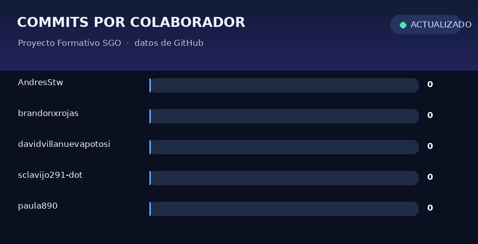

# 📚 Proyecto Formativo SGO

<p align="center">
  
  
  
  
</p>

Repositorio académico del Proyecto Formativo SGO, enfocado en el análisis, la documentación y el desarrollo del sistema de gestión de operaciones de **Sabor Caleño**.

## 📋 Contenido

- **Trimestre I:** requisitos funcionales y no funcionales, presentaciones iniciales, diagramas BPMN y análisis preliminares.
- **Trimestre II:** extensiones del proyecto, presentaciones, cotizaciones, análisis de proveedores y SRS.
- **Trimestre III:** avances y entregables del proyecto.
- **Trimestre IV:** desarrollo del sistema Sabor Caleño SGO.

Explora las carpetas [`Trimestre I`](./Trimestre%20I/), [`Trimestre II`](./Trimestre%20II/), [`Trimestre III`](./Trimestre%20III/) y [`Trimestre IV`](./Trimestre%20IV/).

## 🎯 Objetivos

1. Mejorar la experiencia de usuario en los procesos de gestión organizacional.
2. Consolidar la documentación y los artefactos del proyecto.
3. Facilitar la colaboración entre los integrantes del equipo.
4. Mantener un registro claro de requisitos, análisis y decisiones de diseño.

## 📊 Lenguajes

Composición del código detectada por GitHub para este repositorio. La tabla se actualiza con GitHub Actions.

<!-- languages:start -->

| Lenguaje   |  Tamaño | Proporción |
| ---------- | ------: | ---------: |
| HTML       | 57.3 KB |     48.0 % |
| CSS        | 40.4 KB |     33.9 % |
| JavaScript | 21.6 KB |     18.1 % |

<!-- languages:end -->

[Ver ejecuciones de actualización de lenguajes](https://github.com/AndresStw/Proyecto-Formativo-SGO/actions/workflows/update-language-stats.yml).

## 📈 Commits por colaborador

La animación muestra los commits que GitHub atribuye a los colaboradores de este repositorio. Se actualiza automáticamente con cada cambio en `main` y semanalmente.

<p align="center">
  
</p>

Consulta también la [página de contribuidores](https://github.com/AndresStw/Proyecto-Formativo-SGO/graphs/contributors), el [historial de commits](https://github.com/AndresStw/Proyecto-Formativo-SGO/commits/main/) y la [actividad de commits](https://github.com/AndresStw/Proyecto-Formativo-SGO/graphs/commit-activity).

## 🌿 Ramas

La rama predeterminada es [`main`](https://github.com/AndresStw/Proyecto-Formativo-SGO/tree/main). Revisa [todas las ramas](https://github.com/AndresStw/Proyecto-Formativo-SGO/branches) para ver las ramas de trabajo disponibles.

## 📁 Estructura

```text
Proyecto-Formativo-SGO/
├── .github/
│   ├── scripts/
│   │   └── generate-contributor-chart.py
│   └── workflows/
│       ├── update-language-stats.yml
│       └── update-contributor-stats.yml
├── stats/
│   └── contributors.gif  (generado por GitHub Actions)
├── Trimestre I/
├── Trimestre II/
├── Trimestre III/
├── Trimestre IV/
└── README.md
```
