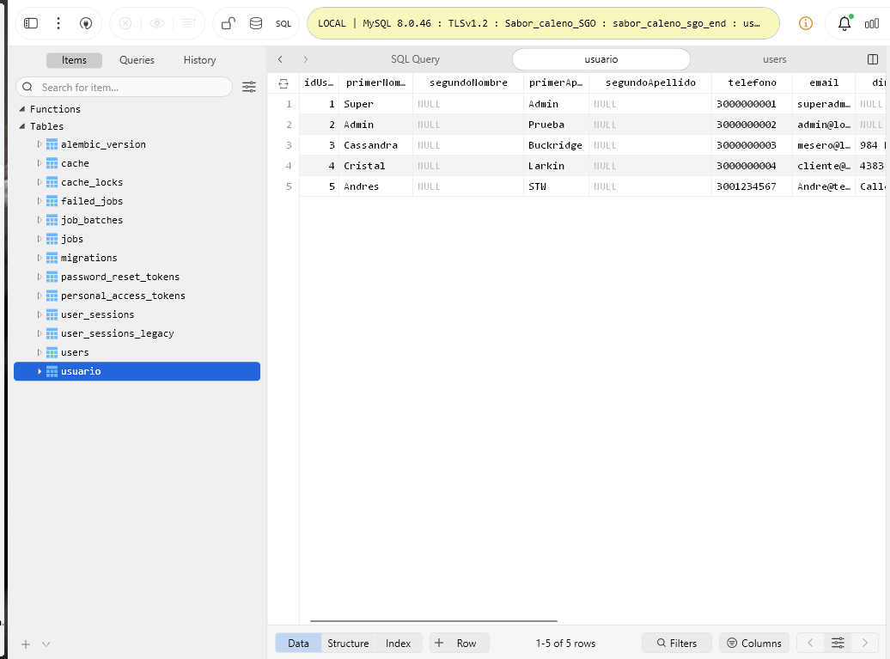

# Backend API — Sabor Caleño SGO

En este README explico los cambios que se hicieron para pasar la parte de **usuarios e inicio de sesión (EP-01)** de Laravel a Python con FastAPI.

El código de Laravel está en la rama `Laravel_Code_Adapted(PHP)` y el de Python en `Backend`.

## ¿Qué se cambió?

| Parte                       | Antes (Laravel)        | Ahora (Python)                               |
| --------------------------- | ---------------------- | -------------------------------------------- |
| Framework                   | Laravel 11             | FastAPI                                      |
| Inicio de sesión            | Laravel Sanctum        | JWT y sesiones guardadas en la base de datos |
| Usuarios                    | Tabla `usuario`        | Tabla `users`                                |
| Cambios en la base de datos | Migraciones de Laravel | SQLAlchemy y Alembic                         |

La idea fue pasar las funciones de EP-01 a Python sin crear otra tabla de usuarios ni cambiar toda la estructura que ya tenía el backend.

## ¿Cómo se hizo?

1. Revisé el controlador, el modelo `Usuario`, las rutas y las migraciones que tenía Laravel.
2. Comparé eso con lo que ya estaba hecho en Python.
3. Pasé los 5 usuarios de `usuario` a `users`, manteniendo sus IDs, contraseñas cifradas, roles y demás datos. La tabla original de Laravel quedó guardada.
4. Agregué las rutas para registro, inicio y cierre de sesión, recuperación de contraseña y consulta de usuarios. También se configuró CORS.
5. Ajusté los campos y roles para que funcionaran en Python. El teléfono no se puede repetir y se sigue usando `password_reset_tokens`.
6. Ajusté las dependencias y la configuración para ejecutar FastAPI de forma local y en Vercel.

Los archivos de migración están en [`migrations/versions/`](./migrations/versions/). En la base de datos local se aplicaron hasta la versión `c9a7d2e84110`.

## Usuarios y base de datos

Se sigue usando una sola tabla de usuarios. Algunos campos tienen nombres distintos en Python, pero la API acepta los nombres que se usaban en Laravel.

| Campo en Laravel  | Campo en Python (`users`) | Para qué sirve                  |
| ----------------- | ------------------------- | ------------------------------- |
| `idUsuario`       | `id`                      | ID del usuario                  |
| `primerNombre`    | `first_name`              | Primer nombre                   |
| `segundoNombre`   | `second_name`             | Segundo nombre (opcional)       |
| `primerApellido`  | `last_name`               | Primer apellido                 |
| `segundoApellido` | `second_last_name`        | Segundo apellido (opcional)     |
| `email`           | `email`                   | Correo, no se puede repetir     |
| `telefono`        | `phone`                   | Teléfono, no se puede repetir   |
| `direccion`       | `address`                 | Dirección (opcional)            |
| `password_hash`   | `password_hash`           | Contraseña cifrada              |
| `rol`             | `role`                    | Rol del usuario                 |
| `estado`          | `is_active`               | Indica si la cuenta está activa |

Cuando alguien se registra, recibe el rol `CLIENTE`. Se mantuvieron los roles que ya tenía Python, como `SUPER_ADMIN`, y se agregaron `MESERO` y `CAJERO`. En las respuestas de la API los roles aparecen en minúsculas, como en Laravel.

## Rutas de EP-01

Se mantuvo `/api` al principio de las rutas para poder seguir usando las solicitudes que ya teníamos en Postman.

| Método | Ruta                   | Quién puede usarla      | Qué hace                                              |
| ------ | ---------------------- | ----------------------- | ----------------------------------------------------- |
| `POST` | `/api/register`        | Cualquiera              | Registra un cliente y devuelve `accessToken` y `user` |
| `POST` | `/api/login`           | Cualquiera              | Inicia sesión y devuelve `accessToken` y `user`       |
| `GET`  | `/api/me`              | Usuario con token       | Muestra su perfil                                     |
| `PUT`  | `/api/me`              | Usuario con token       | Actualiza su perfil                                   |
| `POST` | `/api/logout`          | Usuario con token       | Cierra la sesión actual                               |
| `POST` | `/api/forgot-password` | Cualquiera              | Genera el enlace para recuperar la contraseña         |
| `POST` | `/api/reset-password`  | Cualquiera              | Cambia la contraseña usando el token de recuperación  |
| `GET`  | `/api/users`           | `ADMIN` o `SUPER_ADMIN` | Muestra la lista de usuarios sin sus contraseñas      |
| `POST` | `/api/users`           | `ADMIN` o `SUPER_ADMIN` | Crea cuentas de personal                              |

## Probar la API con Postman

Primero inicia el servidor. Estas son las direcciones locales:

- API: `http://127.0.0.1:8000`
- Documentación de FastAPI: `http://127.0.0.1:8000/docs`

En las solicitudes que llevan datos, usa **Body → raw → JSON** y el encabezado `Content-Type: application/json`.

Cuando te registres o inicies sesión, copia el `accessToken`. Para usar las rutas protegidas, entra a **Authorization → Bearer Token** y pega ese token. Para consultar todos los usuarios necesitas iniciar sesión como `ADMIN` o `SUPER_ADMIN`.

### Registrar usuario — `POST /api/register`

```json
{
  "primerNombre": "Usuario",
  "segundoNombre": "De Prueba",
  "primerApellido": "Ejemplo",
  "segundoApellido": "Lopez",
  "email": "prueba.usuario01@example.com",
  "telefono": "+573001112233",
  "direccion": "Cali",
  "password": "Clave123"
}
```

Si el correo o el teléfono ya existen, usa otros. La respuesta devuelve el token y los datos del usuario.

### Iniciar sesión — `POST /api/login`

```json
{
  "email": "admin@example.com",
  "password": "contraseña_de_la_cuenta"
}
```

Usa el correo y la contraseña de una cuenta que ya exista. Si quieres probar la lista de usuarios, entra con una cuenta administradora.
En entornos `local`, `development` y `testing` también se aceptan correos locales terminados en `.test`, como `admin@local.test`; en `production` se mantiene la validación normal de correo.

### Ver mi perfil — `GET /api/me`

No necesita datos en el Body, pero sí el Bearer Token.

### Actualizar mi perfil — `PUT /api/me`

Necesita Bearer Token. Envía solo los datos que quieras cambiar:

```json
{
  "primerNombre": "Usuario",
  "segundoNombre": "Prueba",
  "primerApellido": "Actualizado",
  "telefono": "+573001112244",
  "direccion": "Nueva dirección"
}
```

### Cerrar sesión — `POST /api/logout`

No necesita Body. Debes enviar el Bearer Token. Después de cerrar sesión, ese token deja de funcionar.

### Pedir recuperación de contraseña — `POST /api/forgot-password`

```json
{
  "email": "correo.existente@example.com"
}
```

Por ahora, el enlace de recuperación aparece en la terminal donde está corriendo FastAPI.

### Cambiar contraseña — `POST /api/reset-password`

Copia el token que aparece en el enlace de recuperación y envíalo así:

```json
{
  "email": "correo.existente@example.com",
  "token": "token_recibido",
  "password": "NuevaClave123",
  "password_confirmation": "NuevaClave123"
}
```

### Ver todos los usuarios — `GET /api/users`

No necesita Body. Solo funciona con el token de un `ADMIN` o `SUPER_ADMIN`. Devuelve los datos de los usuarios, pero no sus contraseñas cifradas. Si entras con una cuenta `CLIENTE`, devuelve el error `403`.

### Crear cuenta de personal — `POST /api/users`

Necesita Bearer Token de `ADMIN` o `SUPER_ADMIN`. El registro público `/api/register` crea solo cuentas `CLIENTE`; para crear personal usa esta ruta y envía un rol permitido:

```json
{
  "primerNombre": "Mesero",
  "primerApellido": "Prueba",
  "email": "mesero.prueba@example.com",
  "telefono": "+573001112255",
  "direccion": "Cali",
  "rol": "MESERO",
  "password": "Clave123"
}
```

Puedes cambiar `rol` por `COCINERO`, `CAJERO` o `ADMIN`. La respuesta `201 Created` contiene el perfil creado y no expone el hash de contraseña. El correo y el teléfono deben ser únicos.

**Otros detalles:** el registro requiere `primerNombre` y `primerApellido`; `segundoNombre` y `segundoApellido` son opcionales. No se acepta un campo combinado `nombre`. También se validan el correo, el teléfono y la contraseña. Desde la actualización del perfil no se puede cambiar el rol ni el estado de la cuenta.

Las rutas anteriores de Python, como `/api/v1/auth/...`, siguen funcionando.

## Inicio de sesión y seguridad

- Las contraseñas nuevas se guardan con **Argon2id**.
- Si una cuenta venía de Laravel con **Bcrypt**, puede iniciar sesión normalmente. Después de entrar, su contraseña se actualiza a Argon2id.
- Para iniciar sesión, Python usa tokens **JWT**. Las sesiones se guardan en `user_sessions` y al cerrar sesión solo se desactiva la sesión actual.
- Los tokens para recuperar contraseñas se guardan cifrados, tienen fecha de vencimiento y solo se pueden usar una vez.
- La función `require_admin` revisa que el usuario tenga rol `ADMIN` o `SUPER_ADMIN`.

Los tokens viejos de Laravel Sanctum no funcionan con JWT. Por eso, aunque se conservó la tabla `personal_access_tokens`, cada usuario debe iniciar sesión otra vez en Python. Las 5 sesiones anteriores quedaron guardadas en `user_sessions_legacy` y sus copias en `user_sessions` quedaron desactivadas.

## CORS

CORS se configuró en FastAPI para las rutas `/api` y `/api/v1`. Los orígenes, métodos y encabezados permitidos se manejan desde variables de entorno.

Para trabajar en local están incluidos `localhost` y `127.0.0.1` en los puertos `5173` y `3000`. También se permite el encabezado `Authorization`.

Cuando se publique el frontend, hay que agregar su dirección exacta a `CORS_ORIGINS` en Vercel. No se debe usar `*` junto con credenciales.

## Base de datos local

Estos son los datos de la conexión que se usó:

| Dato          | Valor                  |
| ------------- | ---------------------- |
| Motor         | MySQL 8.0.46           |
| Host          | `127.0.0.1`            |
| Base de datos | `sabor_caleno_sgo_end` |
| Usuario       | `root`                 |
| Puerto        | `3306`                 |

El ejemplo de configuración está en [`.env.example`](./.env.example). Los datos reales de conexión van en `.env` y no se suben al repositorio.

En la base ya existían tablas de Laravel como `usuario`, `personal_access_tokens` y `migrations`. Se conservaron. La tabla de sesiones anterior pasó a llamarse `user_sessions_legacy` para que Python pudiera usar `user_sessions`.

Se comprobó que los 5 usuarios quedaron en `users`, con estos roles: 2 `CLIENTE`, 1 `MESERO`, 1 `ADMIN` y 1 `SUPER_ADMIN`. Las sesiones anteriores quedaron desactivadas.

## Ejecutar el proyecto en local

Si es la primera vez que lo ejecutas, abre PowerShell en la carpeta del backend y escribe:

```powershell
python -m venv .venv
.\.venv\Scripts\Activate.ps1
pip install -r requirements.txt
if (-not (Test-Path .env)) { Copy-Item .env.example .env }
```

Esto crea el entorno virtual, instala las dependencias y crea `.env` si todavía no existe. **Si ya tienes un `.env` configurado, no lo reemplaces.**

Revisa `DATABASE_URL` y `CORS_ORIGINS` en `.env`. Después inicia el servidor:

```powershell
uvicorn app.main:app --reload --port 8000
```

Puedes entrar a `http://127.0.0.1:8000/docs` para ver y probar las rutas.

### Si ya instalaste todo

Solo necesitas activar el entorno y levantar la API:

```powershell
.\.venv\Scripts\Activate.ps1
uvicorn app.main:app --reload --port 8000
```

Deja la terminal abierta mientras pruebas con Postman. Para detener el servidor, presiona `Ctrl+C`.

Para ejecutar las pruebas automáticas:

```powershell
.\.venv\Scripts\Activate.ps1
pytest -q
```

Si vas a preparar otra base de datos que todavía tiene la estructura de Laravel, configura primero `DATABASE_URL` y luego ejecuta:

```powershell
alembic upgrade head
```

En Vercel se usa [`api/index.py`](./api/index.py) para ejecutar la misma aplicación FastAPI.

## ¿Por qué algunos nombres están en inglés?

En Python se dejaron nombres como `first_name`, `password_hash`, `User` y `get_current_user` porque son fáciles de reconocer y van con la forma en que está organizado el código.

De todas formas, la API sigue aceptando nombres en español como `primerNombre` para que las partes del proyecto que ya los usan no tengan problemas. Los mensajes que ve el usuario también pueden estar en español.

## ¿Qué se revisó al terminar?

- Se aplicaron las migraciones con Alembic hasta `c9a7d2e84110`.
- Se comprobó que hay 5 usuarios en `usuario` y 5 en `users`.
- Se revisaron los 4 roles, las contraseñas cifradas y que no se puedan repetir los teléfonos.
- Las 5 sesiones antiguas quedaron guardadas en `user_sessions_legacy` y desactivadas en Python.
- Se conservaron las tablas `usuario`, `migrations`, `personal_access_tokens` y `password_reset_tokens`.
- También se probó la migración con una base SQLite temporal y datos de ejemplo.
- Las pruebas automáticas de Python habían dado **5 pruebas aprobadas** en SQLite.

**Nota:** las pruebas hechas en Postman con Laravel no comprueban que Python funcione. Para eso hay que probar las rutas con el servidor FastAPI encendido.

## Errores que note y tenemos que corregir

Tenemos dos tablas users y usuarios, cual es el tema tenemos que usar solo una actualmente esta apunta a **users**, tenemos que descartar una.


