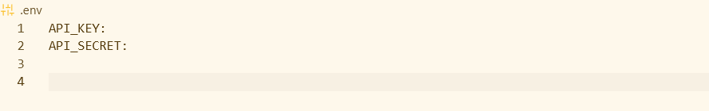

## Rama enfocada al Backend- SGO

> OJO"ARchivo .env no se sube. "



---

# Lenguaje Python

```Python


```

---

## Estructura Proyecto

Directory structure:
└── Proyecto-Formativo-SGO/
├── app/
│ ├── api/
│ │ ├── health.py
│ │ ├── v1/
│ │ │ ├── router.py
│ │ │ └── **init**.py
│ │ └── **init**.py
│ ├── core/
│ │ ├── config.py
│ │ ├── exceptions.py
│ │ └── **init**.py
│ ├── domain/
│ │ ├── entities/
│ │ │ └── **init**.py
│ │ ├── enums/
│ │ │ └── **init**.py
│ │ ├── interfaces/
│ │ │ └── **init**.py
│ │ └── **init**.py
│ ├── infrastructure/
│ │ ├── database/
│ │ │ ├── base.py
│ │ │ ├── connection.py
│ │ │ ├── session.py
│ │ │ └── **init**.py
│ │ └── **init**.py
│ ├── main.py
│ ├── models/
│ │ └── **init**.py
│ ├── repositories/
│ │ └── **init**.py
│ ├── schemas/
│ │ └── **init**.py
│ ├── services/
│ │ └── **init**.py
│ ├── utils/
│ │ └── **init**.py
│ └── **init**.py
├── Backend/
├── README.md
├── requirements.txt
├── scripts/
└── tests/
├── test_health.py
└── **init**.py

---
